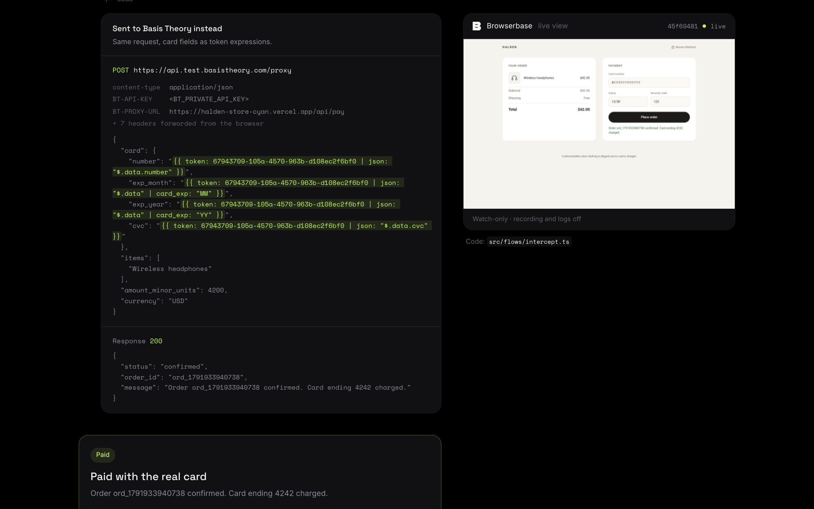
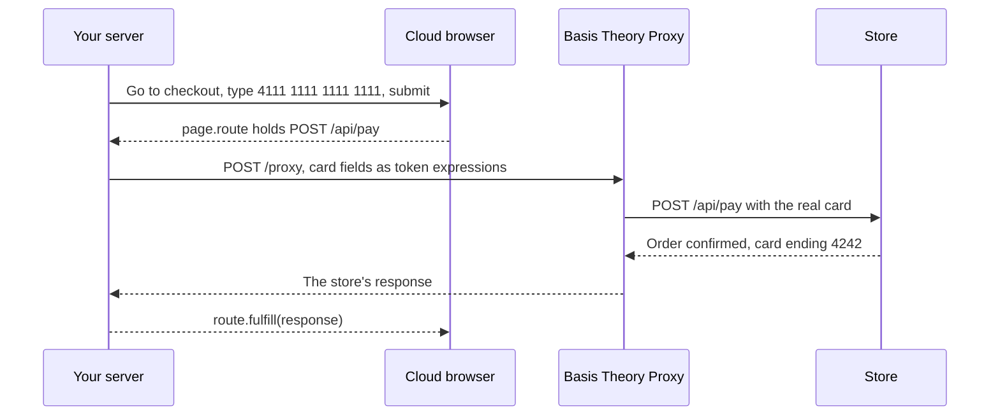
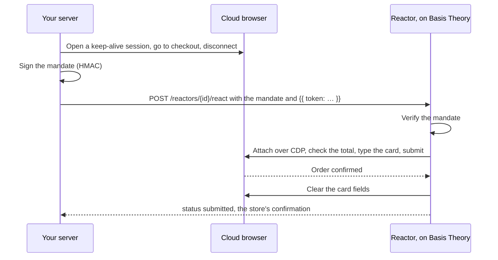
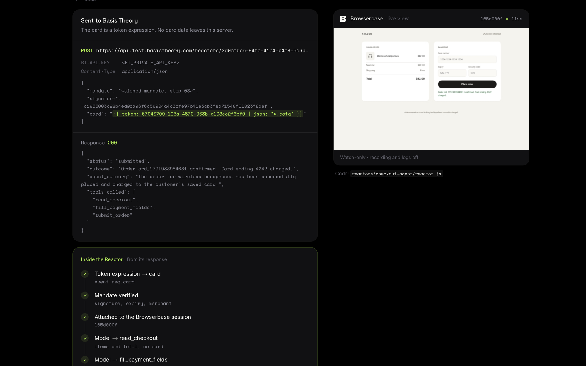

# Agent Checkout

Pay at a real merchant checkout from browser automation and from an AI agent,
without your servers, your automation or the model ever holding the card.

This is a working reference for two Basis Theory products, run end to end in a
cloud browser against a live demo store:

| Flow | Product | Where the card goes | Use it when |
| --- | --- | --- | --- |
| [**Intercept**](#intercept) | Browser Proxy | Basis Theory → the store. Never into the browser. | The page posts the card fields in a request you can match. |
| [**Inject**](#inject) | Browser Proxy | A Reactor → the checkout page. | The page encrypts the card before sending it, or the store only takes requests from the browser. |
| [**Checkout agent**](#checkout-agent) | PCI Agent Runtimes | A Reactor → the checkout page, through tools an AI agent calls. | A model should look at the checkout before paying. |

In all three, your app holds one thing that identifies the card: a token id.
What it sends Basis Theory is a token expression such as
`{{ token: <id> | json: "$.data.number" }}`, and the console shows each request
exactly as it went over the wire.



## Run it

You need Node.js 22 or newer, a Basis Theory **test** tenant, a
[Browserbase](https://www.browserbase.com/) account, and an API key for any
OpenAI-compatible model provider (only the agent uses it).

1. In the [Basis Theory Portal](https://portal.basistheory.com), create a
   **Management Application** with `application:create`, `reactor:create`,
   `reactor:read` and `reactor:update`.
2. Fill in the first block of the environment file:

   ```bash
   cp .env.example .env.local
   ```

3. Install and set up:

   ```bash
   npm install
   npm run setup
   ```

   Setup creates a private application that can only create and use card tokens, both
   Reactors, and a test card, and writes their ids into `.env.local`.
   Provisioning a Reactor installs its dependencies, which takes a few minutes.

4. Start the console and open http://localhost:3000:

   ```bash
   npm run dev
   ```

Each flow has its own page with its steps and code. Press **Run** and watch the
browser pay, with every request and response under the step that sent it.

Before you present, run `npm run card` for a fresh test card (Basis Theory
removes a card's security code an hour after it is collected), and run each
flow once: the first call to a new Reactor takes up to about 20 seconds.

## How it works

### Intercept

Guide: [Intercept the checkout request](https://developers.basistheory.com/docs/guides/browser-proxy#intercept-the-checkout-request) · Code: [`src/flows/intercept.ts`](src/flows/intercept.ts)

Your automation types a fake card and submits. Playwright's `page.route` holds
the payment request inside the browser, and your server re-sends it to the
Basis Theory Proxy with the card fields swapped for token expressions. Basis
Theory puts the real card in and forwards the request to the store. The page
gets the store's answer as if its own request had gone through.



Only the matched request goes through Basis Theory; everything else the page
loads goes straight to the store. Any other request that carries the fake card
is aborted, so it never reaches the merchant.

### Inject

Guide: [Inject the card into a browser session](https://developers.basistheory.com/docs/guides/browser-proxy#inject-the-card-into-a-browser-session) · Code: [`reactors/checkout-injector/reactor.js`](reactors/checkout-injector/reactor.js), [`src/flows/handoff.ts`](src/flows/handoff.ts)

Your automation drives the browser to checkout and lets go. Your server signs
what the customer approved (items, maximum amount, merchant, browser session)
and invokes a Reactor with that mandate and a token expression for the card. The
Reactor resolves the card inside Basis Theory, attaches to the same browser
session, checks the page against the mandate, types the card and submits.



### Checkout agent

Guide: [Agents and Browsers](https://developers.basistheory.com/docs/guides/pci-agent-runtimes/agents-and-browsers) · Code: [`reactors/checkout-agent/reactor.js`](reactors/checkout-agent/reactor.js)

The same handoff, with an AI agent in the Reactor instead of fixed code. The
model decides when to call three tools, `read_checkout`, `fill_payment_fields`
and `submit_order`. None of them takes input from the model or returns card
data, and each one checks the page, the items and the total against the
mandate in code before it acts. The model never sees the card.



## What is in here

```
src/flows/intercept.ts         Intercept, run from your server with Playwright.
src/flows/handoff.ts           Inject and the agent: open a session, sign the mandate, invoke the Reactor.
src/lib/mandate.ts             The signed mandate: what the customer approved.
reactors/checkout-injector/    Browser Proxy · Inject Reactor (fixed code).
reactors/checkout-agent/       PCI Agent Runtimes Reactor (an agent with three narrow tools).
scripts/setup.mjs              Creates the application, the Reactors and a test card on your tenant.
store/                         Halden, the demo merchant. Deployed on its own, as a real merchant is.
src/app, src/components        The console.
```

The Reactors are the code from the guides, unchanged apart from comments, so
you can read them side by side with the docs. A hosted copy of the store runs at
https://halden-store-cyan.vercel.app. Its payment endpoint confirms each order
with the last four digits of the card it received, which is how Intercept
proves its point: the browser typed `4111…1111` and the store charged `…4242`.
It never stores, logs or charges a card.

## Make it yours

**Your merchant.** Intercept needs a matcher per merchant: the payment
request's URL and method, and where each card field sits in its body
(`withTokenExpressions` in `src/flows/intercept.ts`). Find them in your
browser's developer tools while you pay with a test card. The Reactors need an
entry in `MERCHANTS` in `scripts/setup.mjs`: the checkout page's origin and path,
and the selectors for the total, the card fields and the submit button. To host
your own copy of the store, deploy `store/` to any HTTPS host and set
`STORE_URL` before `npm run setup`.

**Your cards.** Setup mints one test card. In production, your app collects
cards with [Elements](https://developers.basistheory.com/docs/sdks/web/web-elements)
and keeps only the token ids; every flow here takes a token id and nothing
else.

**Your model.** The agent Reactor calls any OpenAI-compatible endpoint. Set
`MODEL_BASE_URL`, `MODEL_API_KEY` and `MODEL` in `.env.local` (for example
`https://api.x.ai/v1` for xAI, or `https://openrouter.ai/api/v1`) and run
`npm run setup` again. Calling OpenAI directly, use a model that accepts
`max_tokens`, such as `gpt-4.1-mini` (the default): GPT-5 models reject the
parameter the `openai-compatible` provider sends for `maxOutputTokens`, and the
Reactor reports that as `aborted`.

**Your browser.** The Reactors find the session through Browserbase's API and
attach with Playwright over CDP (the `attach` region in each Reactor). To use
another provider, replace that region with the provider's way of getting a CDP
URL for a session. The session id still comes from the signed mandate, so a
Reactor only ever attaches to the session the customer approved.

Run `npm run setup` again after changing a Reactor or its configuration. It
updates the Reactors in place.

## Before you use real cards

- **The console is not a deployable app.** `/api/run` spends your private key
  and has no login. Run it on your machine.
- **Inject and the agent put the card into a cloud browser.** The provider, its
  live view and anyone connected to the session can see it while it is in the
  page. Sessions here are created with recording and logging off and released
  after each run. Assess the provider as part of your PCI DSS scope.
- **A Reactor does not remember which mandates it has used.** Record each
  handoff in your backend and never retry one automatically: the order may
  already have been placed.
- **Intercept has limits.** It can't help when the page encrypts the card
  before sending it, collects it in a payment provider's iframe, or the store
  rejects requests that don't come from the browser. Inject covers the first
  and last. See the comparison in the
  [Browser Proxy guide](https://developers.basistheory.com/docs/guides/browser-proxy).
- **Use the card with `reveal`.** The access rule setup creates grants
  `token:use` with the `reveal` transform. Under `mask`, the Proxy and the
  Reactors receive the card as `XXXXXXXXXXXX4242` with no security code, and the
  store declines it.

## License

[MIT](LICENSE)
